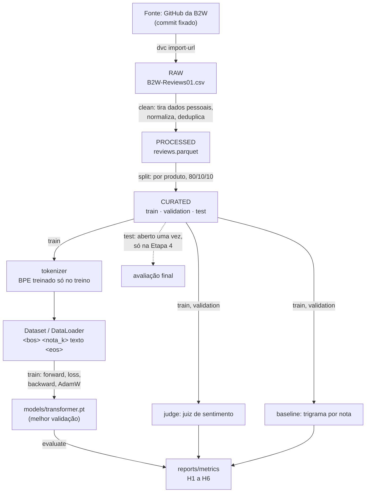

# nano-review

Transformer pequeno, **treinado do zero** (sem modelo pré-treinado), que gera resenhas de
produto em português a partir de uma nota de 1 a 5. Projeto integrador individual.

- **Dados:** B2W-Reviews01 (licença CC BY-NC-SA 4.0; origem e esquema ficam no manifesto em `docs/`).
- **Usuário:** desenvolvedor que precisa de textos sintéticos para testar telas, moderação ou
  classificadores de sentimento. A IA não serve para publicar avaliações falsas.

## Status

- Etapa 0 concluída: esqueleto do repositório, ambiente e porta de qualidade (`make check`).
- Etapa 1 concluída: charter com a hipótese e os limiares (`docs/charter.md`), dados brutos com
  manifesto (`docs/data_manifest.md`), EDA (`notebooks/01_eda.ipynb`), limpeza e split por produto,
  rubrica humana (`docs/rubric.md`), juiz de sentimento e baseline de n-gramas (`dvc.yaml`).
- Etapa 2 concluída: tokenizador BPE treinado só no treino (`notebooks/02_tokenization.ipynb`),
  DataLoader com lotes agrupados por comprimento, bigrama neural com forward e backward conferidos à
  mão (`notebooks/03_forward_backward.ipynb`), Transformer com a atenção escrita à mão, primeiro
  treino e curva (`reports/figures/train_curve.png`) e análise da atenção
  (`notebooks/04_attention.ipynb`).

## Como preparar o ambiente (WSL/Ubuntu, Python 3.12)

Mantenha o projeto dentro do sistema de arquivos do WSL (por exemplo `~/workspace/nano-review`),
fora de `/mnt/c` e de pastas sincronizadas pelo OneDrive.

```bash
# Se o comando abaixo reclamar de ensurepip/venv: sudo apt install python3.12-venv
python3.12 -m venv .venv
source .venv/bin/activate
pip install --upgrade pip

# O torch (build CPU) vem do índice próprio da PyTorch; instalar antes do resto.
pip install torch --index-url https://download.pytorch.org/whl/cpu

pip install -r requirements-dev.txt
make check
```

`make check` roda `ruff` (estilo), `mypy --strict` (tipos) e `pytest` (testes). Ele precisa
passar antes de qualquer commit ou entrega.

## Estrutura

```text
nano-review/
├── src/nano_review/        # código do pacote Python
│   ├── data/               # limpeza, split por produto, Dataset e DataLoader
│   ├── tokenization/       # tokenizador BPE e um BPE didático escrito à mão
│   ├── models/             # bigrama neural e Transformer (atenção à mão)
│   ├── training/           # laço de treino, checkpoint e export do MLflow
│   ├── baseline/           # juiz de sentimento e geradores de n-gramas
│   ├── evaluation/         # métricas, avaliação do Transformer e rubrica
│   └── reproducibility.py  # set_seed: mesma semente, mesmo resultado
├── tests/                  # testes automatizados (make check)
├── notebooks/              # EDA, tokenização, forward/backward e atenção
├── docs/                   # charter, manifesto, rubrica e experimentos
├── data/                   # versionada pelo DVC (ver a seção abaixo)
│   ├── raw/                # CSV original, nunca editado
│   ├── processed/          # limpo, sem dados pessoais, sem duplicatas
│   └── curated/            # train, validation e test, split por produto
├── models/                 # tokenizador, juiz e Transformer (DVC)
├── reports/
│   ├── metrics/            # métricas geradas pelo pipeline (JSON)
│   ├── figures/            # figuras dos notebooks e do treino
│   ├── samples/            # amostras geradas pelos modelos
│   ├── experiments/        # runs do MLflow exportadas (CSV)
│   └── rubric/             # planilha às cegas e a chave, separada
├── configs/                # reservada, vazia por enquanto
├── params.yaml             # parâmetros de todos os estágios
├── dvc.yaml                # estágios do pipeline
├── dvc.lock                # hashes da última execução de cada estágio
├── requirements.txt        # dependências do projeto
├── requirements-dev.txt    # ferramentas: ruff, mypy, pytest
└── Makefile                # make check
```

## Dados e modelos (DVC)

`data/` e `models/` são versionados pelo **DVC**, não pelo Git. O Git guarda só os arquivos `.dvc`
(um ponteiro com o hash do conteúdo); os arquivos grandes ficam no cache do DVC e no remote.

```
data/raw/        download original (GitHub da B2W, via `dvc import-url`); nunca editar à mão
data/processed/  limpo, deduplicado, sem dados pessoais
data/curated/    splits prontos (train, validation, test), feitos por produto
models/          checkpoints treinados
```

As pastas nascem quando o primeiro arquivo chega (sem `.gitkeep`: se o Git rastreasse um arquivo
dentro de uma pasta, o `dvc add` dessa pasta falharia com "already tracked by SCM").

O remote padrão é uma pasta local fora do repositório (`~/dvc-storage/nano-review`):

```bash
mkdir -p ~/dvc-storage/nano-review   # só na primeira vez em uma máquina nova
dvc pull                             # baixa do remote os dados que o Git aponta
dvc push                             # envia para o remote os dados novos
```

### Pipeline (dos dados ao modelo)

`data/processed` e `data/curated` não são baixados nem editados: são **gerados** pelo pipeline do
`dvc.yaml`, com os parâmetros do `params.yaml`. Cada seta é um estágio, e o DVC só refaz um estágio
quando a entrada, o código ou um parâmetro dele muda:



```bash
source .venv/bin/activate   # os comandos do pipeline usam o python do .venv
dvc repro                   # refaz só o que mudou (código, dado de entrada ou parâmetro)
dvc metrics show            # funil da limpeza e tamanhos do split
```

| Estágio | Entrada | Saída |
|---|---|---|
| `clean` | `data/raw/B2W-Reviews01.csv` | `data/processed/reviews.parquet`, `reports/metrics/cleaning.json` |
| `split` | `data/processed/reviews.parquet` | `data/curated/{train,validation,test}.parquet`, `reports/metrics/split.json` |
| `judge` | `train`, `validation` | `models/judge.joblib`, `reports/metrics/judge.json` |
| `baseline` | `train`, `validation`, juiz | `reports/metrics/baseline.json`, `reports/samples/baseline.jsonl` |
| `tokenizer` | `train` (a validação só é medida) | `models/tokenizer.json`, `reports/metrics/tokenizer.json` |
| `train` | `train`, `validation`, tokenizador | `models/transformer.pt`, `reports/metrics/train.json`, `train_log.csv`, `reports/figures/train_curve.png` |
| `evaluate` | checkpoint, tokenizador, juiz, `train`, `validation` | `reports/metrics/transformer_eval.json` (H1 a H6), `reports/samples/transformer_eval.jsonl` |

O treino do Transformer, na configuração final da Etapa 3, leva ~66 minutos em CPU (16 núcleos), e
a avaliação, ~4 minutos. `dvc plots show` desenha a curva de
treino e validação a partir de `reports/metrics/train_log.csv`.

O split é **por produto** (nenhum produto aparece em dois conjuntos), com 80/10/10 das resenhas.
**`test.parquet` não é lido por nada até a Etapa 4**: o teste é aberto uma única vez, no fim.

## Experimentos (Etapa 3)

Cada experimento muda **uma** variável e tem a hipótese escrita em `docs/experiments.md` **antes** de
rodar. O DVC guarda a configuração de cada um, e o MLflow mostra a comparação:

```bash
source .venv/bin/activate
dvc exp run -n e2-lr-1e-3 --set-param train.learning_rate=0.001   # treina e avalia com um parâmetro trocado
dvc exp show                                                      # tabela: parâmetros e métricas de cada experimento
mlflow ui --host 127.0.0.1 --port 5000                            # painel em http://127.0.0.1:5000
```

- O nome dado com `-n` vira o nome do run no MLflow, e assim os dois se cruzam.
- O `train` grava no run os parâmetros, a curva passo a passo e os artefatos. O `evaluate` acrescenta
  H1 a H6 ao **mesmo** run.
- O treino para sozinho (early stopping) quando a validação passa `train.patience` avaliações sem
  melhorar. O checkpoint é sempre o da melhor validação.
- Rode um experimento por vez, na pasta do projeto: o `mlflow.db` e a pasta `mlruns/` ficam aqui, fora
  do Git. Os números que contam continuam versionados em `reports/metrics/`.
- Para promover um experimento ao workspace: `dvc exp apply <nome>`.
- Como o MLflow fica fora do Git, as runs são exportadas para `reports/experiments/`: `runs.csv`
  (parâmetros e métricas finais de cada run) e `curves.csv` (as curvas passo a passo). Depois de
  rodar experimentos novos, atualize com
  `python -m nano_review.training.export_runs --out-dir reports/experiments`.
