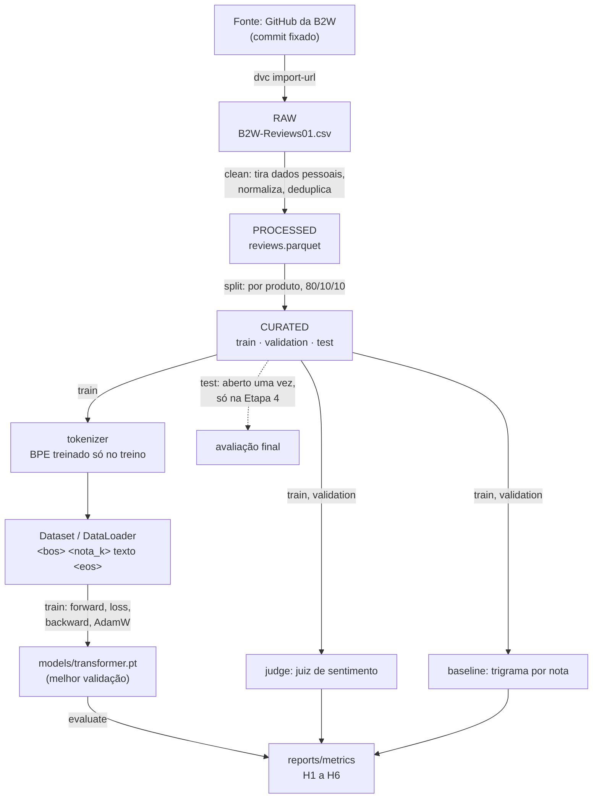

# nano-review

Transformer pequeno, **treinado do zero** (sem modelo pré-treinado), que gera resenhas de
produto em português a partir de uma nota de 1 a 5. Projeto integrador individual.

- **Dados:** B2W-Reviews01 (licença CC BY-NC-SA 4.0; origem e esquema ficam no manifesto em `docs/`).
- **Usuário:** desenvolvedor que precisa de textos sintéticos para testar telas, moderação ou
  classificadores de sentimento. A IA não serve para publicar avaliações falsas.

## Status

- Etapa 0 concluída: esqueleto do repositório, ambiente e porta de qualidade (`make check`).
- Etapa 1 concluída: charter com a hipótese e os limiares (`docs/charter.md`), dados brutos com
  manifesto (`docs/data_manifest.md`), EDA (`notebooks/01_eda.ipynb`), limpeza e split por produto,
  rubrica humana (`docs/rubric.md`), juiz de sentimento e baseline de n-gramas (`dvc.yaml`).
- Etapa 2 concluída: tokenizador BPE treinado só no treino (`notebooks/02_tokenization.ipynb`),
  DataLoader com lotes agrupados por comprimento, bigrama neural com forward e backward conferidos à
  mão (`notebooks/03_forward_backward.ipynb`), Transformer com a atenção escrita à mão, primeiro
  treino e curva (`reports/figures/train_curve.png`) e análise da atenção
  (`notebooks/04_attention.ipynb`).
- Etapa 3 concluída:
  - experimentos com a hipótese escrita antes de cada run (`docs/experiments.md`), registrados no
    MLflow e exportados para `reports/experiments/`;
  - checkpoint final aprovado em H1 a H6 na validação (`docs/charter.md`, seção 7.1);
  - rubrica humana às cegas, o H3 (`docs/rubric.md`), e análise de erros
    (`docs/error_analysis.md`).

## Como preparar o ambiente (WSL/Ubuntu, Python 3.12)

Mantenha o projeto dentro do sistema de arquivos do WSL (por exemplo `~/workspace/nano-review`),
fora de `/mnt/c` e de pastas sincronizadas pelo OneDrive.

```bash
# Se o comando abaixo reclamar de ensurepip/venv: sudo apt install python3.12-venv
python3.12 -m venv .venv
source .venv/bin/activate
pip install --upgrade pip

# O torch (build CPU) vem do índice próprio da PyTorch; instalar antes do resto.
pip install torch --index-url https://download.pytorch.org/whl/cpu

pip install -r requirements-dev.txt
make check
```

`make check` roda `ruff` (estilo), `mypy --strict` (tipos) e `pytest` (testes). Ele precisa
passar antes de qualquer commit ou entrega.

## Estrutura

```text
nano-review/
├── src/nano_review/        # código do pacote Python
│   ├── data/               # limpeza, split por produto, Dataset e DataLoader
│   ├── tokenization/       # tokenizador BPE e um BPE didático escrito à mão
│   ├── models/             # bigrama neural e Transformer (atenção à mão)
│   ├── training/           # laço de treino, checkpoint e export do MLflow
│   ├── baseline/           # juiz de sentimento e geradores de n-gramas
│   ├── evaluation/         # métricas, avaliação, rubrica e análise de erros
│   ├── inference/          # sorteio (temperatura, top-k) e gerador com filtros
│   ├── api/                # API FastAPI e a página de demonstração
│   └── reproducibility.py  # set_seed: mesma semente, mesmo resultado
├── tests/                  # testes automatizados (make check)
├── notebooks/              # EDA, tokenização, forward/backward e atenção
├── docs/                   # charter, manifesto, rubrica, experimentos, erros
├── data/                   # versionada pelo DVC (ver a seção abaixo)
│   ├── raw/                # CSV original, nunca editado
│   ├── processed/          # limpo, sem dados pessoais, sem duplicatas
│   └── curated/            # train, validation e test, split por produto
├── models/                 # tokenizador, juiz e Transformer (DVC)
├── reports/
│   ├── metrics/            # métricas do pipeline e da rubrica (JSON)
│   ├── figures/            # figuras dos notebooks e do treino
│   ├── samples/            # amostras geradas pelos modelos
│   ├── experiments/        # runs do MLflow exportadas (CSV)
│   └── rubric/             # planilha cega, chave e tipos de erro
├── configs/                # reservada, vazia por enquanto
├── params.yaml             # parâmetros de todos os estágios
├── dvc.yaml                # estágios do pipeline
├── dvc.lock                # hashes da última execução de cada estágio
├── requirements.txt        # dependências do projeto
├── requirements-dev.txt    # ferramentas: ruff, mypy, pytest
├── requirements-api.txt    # só o que a API importa, para o Docker
├── Dockerfile              # imagem da API com o modelo final
├── .dockerignore           # o que pode entrar na imagem
└── Makefile                # make check, docker-build, docker-run
```

## Dados e modelos (DVC)

`data/` e `models/` são versionados pelo **DVC**, não pelo Git. O Git guarda só os arquivos `.dvc`
(um ponteiro com o hash do conteúdo); os arquivos grandes ficam no cache do DVC e no remote.

```
data/raw/        download original (GitHub da B2W, via `dvc import-url`); nunca editar à mão
data/processed/  limpo, deduplicado, sem dados pessoais
data/curated/    splits prontos (train, validation, test), feitos por produto
models/          checkpoints treinados
```

As pastas nascem quando o primeiro arquivo chega (sem `.gitkeep`: se o Git rastreasse um arquivo
dentro de uma pasta, o `dvc add` dessa pasta falharia com "already tracked by SCM").

O remote padrão é uma pasta local fora do repositório (`~/dvc-storage/nano-review`):

```bash
mkdir -p ~/dvc-storage/nano-review   # só na primeira vez em uma máquina nova
dvc pull                             # baixa do remote os dados que o Git aponta
dvc push                             # envia para o remote os dados novos
```

### Pipeline (dos dados ao modelo)

`data/processed` e `data/curated` não são baixados nem editados: são **gerados** pelo pipeline do
`dvc.yaml`, com os parâmetros do `params.yaml`. Cada seta é um estágio, e o DVC só refaz um estágio
quando a entrada, o código ou um parâmetro dele muda:



```bash
source .venv/bin/activate   # os comandos do pipeline usam o python do .venv
dvc repro                   # refaz só o que mudou (código, dado de entrada ou parâmetro)
dvc metrics show            # funil da limpeza e tamanhos do split
```

| Estágio | Entrada | Saída |
|---|---|---|
| `clean` | `data/raw/B2W-Reviews01.csv` | `data/processed/reviews.parquet`, `reports/metrics/cleaning.json` |
| `split` | `data/processed/reviews.parquet` | `data/curated/{train,validation,test}.parquet`, `reports/metrics/split.json` |
| `judge` | `train`, `validation` | `models/judge.joblib`, `reports/metrics/judge.json` |
| `baseline` | `train`, `validation`, juiz | `reports/metrics/baseline.json`, `reports/samples/baseline.jsonl` |
| `tokenizer` | `train` (a validação só é medida) | `models/tokenizer.json`, `reports/metrics/tokenizer.json` |
| `train` | `train`, `validation`, tokenizador | `models/transformer.pt`, `reports/metrics/train.json`, `train_log.csv`, `reports/figures/train_curve.png` |
| `evaluate` | checkpoint, tokenizador, juiz, `train`, `validation` | `reports/metrics/transformer_eval.json` (H1 a H6), `reports/samples/transformer_eval.jsonl` |

O treino do Transformer, na configuração final da Etapa 3, leva ~66 minutos em CPU (16 núcleos), e
a avaliação, ~4 minutos. `dvc plots show` desenha a curva de
treino e validação a partir de `reports/metrics/train_log.csv`.

O split é **por produto** (nenhum produto aparece em dois conjuntos), com 80/10/10 das resenhas.
**`test.parquet` não é lido por nada até a Etapa 4**: o teste é aberto uma única vez, no fim.

## Experimentos (Etapa 3)

Cada experimento muda **uma** variável e tem a hipótese escrita em `docs/experiments.md` **antes** de
rodar. O DVC guarda a configuração de cada um, e o MLflow mostra a comparação:

```bash
source .venv/bin/activate
dvc exp run -n e2-lr-1e-3 --set-param train.learning_rate=0.001   # treina e avalia com um parâmetro trocado
dvc exp show                                                      # tabela: parâmetros e métricas de cada experimento
mlflow ui --host 127.0.0.1 --port 5000                            # painel em http://127.0.0.1:5000
```

- O nome dado com `-n` vira o nome do run no MLflow, e assim os dois se cruzam.
- O `train` grava no run os parâmetros, a curva passo a passo e os artefatos. O `evaluate` acrescenta
  H1 a H6 ao **mesmo** run.
- O treino para sozinho (early stopping) quando a validação passa `train.patience` avaliações sem
  melhorar. O checkpoint é sempre o da melhor validação.
- Rode um experimento por vez, na pasta do projeto: o `mlflow.db` e a pasta `mlruns/` ficam aqui, fora
  do Git. Os números que contam continuam versionados em `reports/metrics/`.
- Para promover um experimento ao workspace: `dvc exp apply <nome>`.
- Como o MLflow fica fora do Git, as runs são exportadas para `reports/experiments/`: `runs.csv`
  (parâmetros e métricas finais de cada run) e `curves.csv` (as curvas passo a passo). Depois de
  rodar experimentos novos, atualize com
  `python -m nano_review.training.export_runs --out-dir reports/experiments`.

## Rubrica humana e análise de erros (Etapa 3)

A rubrica não é estágio do DVC: a planilha pontuada é trabalho humano, e um `dvc repro` não pode
regerá-la. Os três passos rodam à mão, nesta ordem:

```bash
source .venv/bin/activate
# 1. Monta o lote cego: a planilha sem a origem e, separada, a chave. Recusa sobrescrever um lote.
python -m nano_review.evaluation.rubric batch --trigram reports/samples/baseline.jsonl \
    --transformer reports/samples/transformer_eval.jsonl \
    --validation data/curated/validation.parquet --tokenizer models/tokenizer.json \
    --block-size 128 --out-dir reports/rubric --per-rating 20 --seed 2026
# 2. Depois de pontuar reports/rubric/sheet_v1.csv: abre a chave e calcula o H3.
python -m nano_review.evaluation.rubric summarize --sheet reports/rubric/sheet_v1.csv \
    --key reports/rubric/key_v1.csv --metrics reports/metrics/rubric.json
# 3. Mede as causas das amostras ruins, a partir da classificação feita à mão.
python -m nano_review.evaluation.error_analysis --sheet reports/rubric/sheet_v1.csv \
    --key reports/rubric/key_v1.csv --types reports/rubric/error_types_v1.csv \
    --train data/curated/train.parquet --metrics reports/metrics/error_analysis.json
```

- As regras de pontuação estão em `docs/rubric.md`. O lote v1 foi pontuado com a versão 1.0; a 1.1
  vale para as avaliações seguintes.
- A chave (`key_v1.csv`) só é aberta depois que a planilha inteira foi pontuada.

O lote v2 (Etapa 4.3, rubrica v1.1) lê as fontes de arquivos `.jsonl` e exclui os textos já lidos no
v1 (`docs/final_test.md`). O `--version` do `summarize` precisa ser o da rubrica usada (o padrão é
1.0):

```bash
python -m nano_review.evaluation.rubric batch-jsonl \
    --source transformer=reports/samples/inference.jsonl@t1.0-k0 \
    --source transformer_k50=reports/samples/inference.jsonl@t1.0-k50 \
    --source real=reports/samples/test_real_control.jsonl \
    --exclude reports/rubric/sheet_v1.csv --per-rating 10 --seed 2029 \
    --out-dir reports/rubric --suffix _v2 --version 1.1
python -m nano_review.evaluation.rubric summarize --sheet reports/rubric/sheet_v2.csv \
    --key reports/rubric/key_v2.csv --metrics reports/metrics/rubric_v2.json --version 1.1
```

## API e página de demonstração (Etapa 4)

A API serve o gerador do produto (`nano_review.inference.generator`): a decodificação escolhida na
Etapa 4.1 e os filtros da 4.2 (`docs/inference.md`). O modelo carrega uma vez, quando a API sobe.

```bash
source .venv/bin/activate
uvicorn nano_review.api.app:app --host 127.0.0.1 --port 8000
```

O `127.0.0.1` deixa a API visível só nesta máquina. Ela não tem autenticação nem limite de pedidos,
porque foi feita para a demonstração e para testes locais. No Docker (Etapa 4.5), ela escuta em
`0.0.0.0` **dentro** do contêiner, e quem decide o que fica exposto é a porta publicada.

| Rota | O que faz |
|---|---|
| `GET /` | Página de demonstração: escolher a nota e a quantidade, gerar e copiar as resenhas (o estilo e o script dela ficam em `/static`) |
| `GET /docs` | Documentação automática, onde dá para testar cada rota |
| `GET /health` | Se o modelo está carregado, o número de parâmetros, o hash do checkpoint e os padrões |
| `POST /generate` | As resenhas para uma nota |

```bash
curl -X POST http://127.0.0.1:8000/generate \
  -H "Content-Type: application/json" \
  -d '{"rating": 5, "n": 3}'
```

| Campo do pedido | Aceito | Padrão |
|---|---|---|
| `rating` | inteiro de 1 a 5 | obrigatório |
| `n` | inteiro de 1 a 20 | 1 |
| `temperature` | de 0,1 a 2 | 1,0 |
| `top_k` | inteiro de 0 ao tamanho do vocabulário (8.000); 0 pede "sem top-k" | sem top-k |
| `seed` | inteiro de 0 a 2⁶³ − 1; o mesmo pedido com a mesma semente repete o texto | sorteada (abaixo de 2⁵³, para o JavaScript da página não arredondar), e devolvida na resposta |

- **422, pedido inválido:** tipo errado, fora do intervalo ou campo que não existe. O `detail` vem
  em dois formatos: uma lista (`type`, `loc`, `msg`), quando o formato do pedido está errado, ou um
  texto, quando o pedido é bem formado mas o gerador o recusa (um top-k maior que o vocabulário).
- **503, tentativas esgotadas:** quando as 5 tentativas de um texto caem nos filtros, o pedido
  **inteiro** falha, com os motivos, e as resenhas já geradas são descartadas. Com o padrão, isso não
  aconteceu em 3.000 resenhas. Longe dele, acontece: em 20 pedidos de uma resenha, 2 falharam com
  temperatura 0,1 e 1 com temperatura 2,0. Num pedido de várias resenhas, a chance de falha cresce
  com o número delas.
- **Toda resposta traz `"synthetic": true` e o aviso de que o texto é sintético.** Ele serve para
  testar software e não pode ser publicado como avaliação de um cliente real (`docs/charter.md`,
  seção 9).
- **Os caminhos do modelo** vêm das variáveis de ambiente `NANO_REVIEW_CHECKPOINT` e
  `NANO_REVIEW_TOKENIZER`, com o padrão `models/transformer.pt` e `models/tokenizer.json`.

## Docker (Etapa 4.5)

A imagem traz a API, a página e o modelo final, e roda em qualquer máquina com Docker, sem `.venv`,
DVC nem dados. O modelo precisa estar em `models/` antes do build (só os dois arquivos que entram na
imagem; um `dvc pull` sem argumentos traria também todos os dados):

```bash
dvc pull models/transformer.pt models/tokenizer.json
```

```bash
make docker-build
```

```bash
make docker-run
```

Depois é só abrir <http://127.0.0.1:8000>. O `make docker-run` publica a porta só em `127.0.0.1`,
porque a API não tem autenticação. Para parar, use `Ctrl+C` ou `docker stop nano-review`. Se a
porta 8000 já estiver ocupada (por exemplo, pela API rodando no `.venv`), pare o outro processo ou
escolha outra porta:

```bash
make docker-run PORT=8001
```

A página e a API funcionam sem internet. O `/docs` não: a documentação automática do FastAPI carrega
o estilo e o script de uma CDN, e fica em branco offline.

- **O que entra na imagem:** o `.dockerignore` é uma lista do que **pode** entrar (o `src/`, o
  `pyproject.toml`, o `requirements-api.txt` e os dois arquivos do modelo). Dados, `.git`, `.venv`,
  MLflow e relatórios ficam de fora.
- **As dependências:** o torch CPU 2.15.0 e as bibliotecas do `requirements-api.txt`, todas nas
  versões exatas do `.venv`, inclusive as indiretas (o que as bibliotecas puxam). Elas incluem o joblib e o scikit-learn, porque o gerador importa uma função de
  `evaluation/metrics.py`, e esse módulo importa o juiz de sentimento.
- **O tamanho:** ~2 GB. O torch sozinho ocupa ~970 MB; as outras bibliotecas, ~420 MB; o modelo,
  22 MB.
- **A segurança:** a API roda como o usuário `app`, sem privilégios de root.
- **A saúde:** um `HEALTHCHECK` chama o `/health` a cada 30 s, e o `docker ps` mostra o contêiner
  como `healthy`. A API sobe em uns 5 s.
