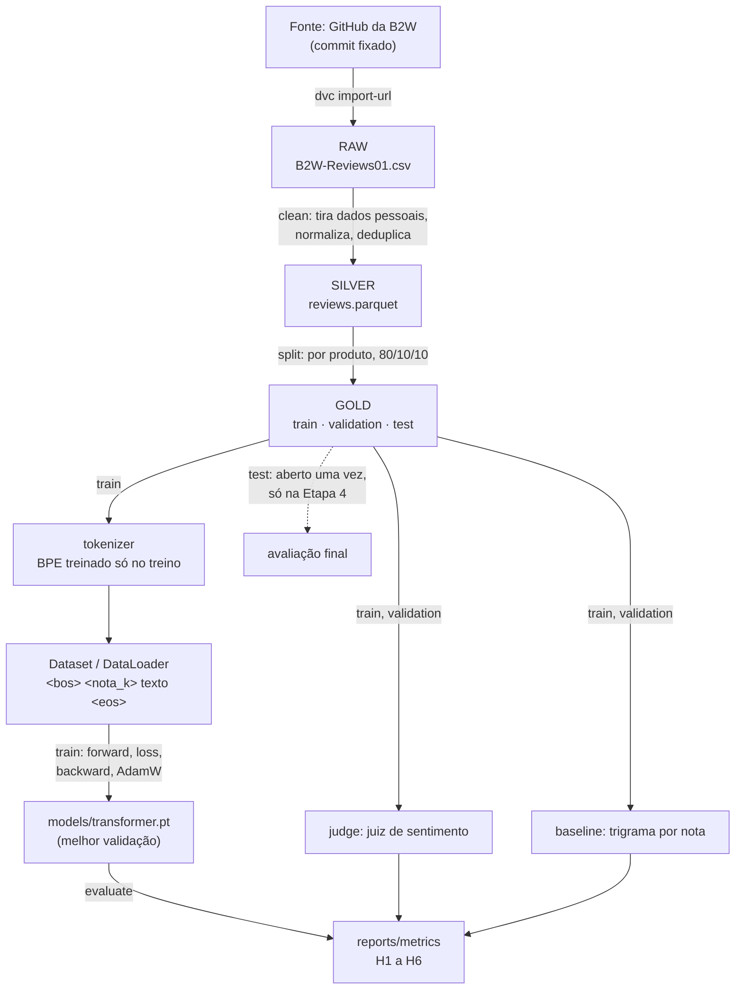

# nano-review

Transformer pequeno, **treinado do zero** (sem modelo pré-treinado), que gera resenhas de
produto em português a partir de uma nota de 1 a 5. Projeto integrador individual.

- **Dados:** B2W-Reviews01 (CC BY-NC-SA 4.0; origem e esquema em [`docs/data_manifest.md`](docs/data_manifest.md)).
- **Usuário:** desenvolvedor que precisa de textos sintéticos para testar telas, moderação ou
  classificadores de sentimento. **Os textos são sintéticos e não podem ser publicados como
  avaliações reais.**
- **Status:** Etapas 0 a 4 concluídas; Etapa 5 (reprodução, relatório e defesa) em andamento.
- **Resultado no teste** (aberto uma única vez): perplexity por palavra de **68,94**, contra 88,87
  do baseline de trigramas nas mesmas resenhas (menor é melhor). Detalhes em [`docs/final_test.md`](docs/final_test.md).

## Ambiente (WSL/Ubuntu, Python 3.12)

Mantenha o projeto dentro do sistema de arquivos do WSL (por exemplo `~/workspace/nano-review`),
fora de `/mnt/c` e de pastas sincronizadas pelo OneDrive.

```bash
# Se o comando abaixo reclamar de ensurepip/venv: sudo apt install python3.12-venv
python3.12 -m venv .venv
source .venv/bin/activate
pip install --upgrade pip

# O torch (build CPU) vem do índice próprio da PyTorch; instalar antes do resto.
pip install torch==2.15.0 --index-url https://download.pytorch.org/whl/cpu

# Versões exatas com que os resultados foram obtidos, inclusive as indiretas.
pip install -r requirements-lock.txt
make check
```

`make check` roda `ruff` (estilo), `mypy --strict` (tipos) e `pytest` (testes), e precisa passar
antes de qualquer entrega.

As dependências ficam em dois níveis. [`requirements.txt`](requirements.txt) e
[`requirements-dev.txt`](requirements-dev.txt) dizem do que o projeto depende, só com versões
mínimas. [`requirements-lock.txt`](requirements-lock.txt) fixa as versões exatas do ambiente que gerou
os resultados. Depois de mudar uma dependência e ver o `make check` passar, `make lock` o regenera.

## Rodar a demonstração

**1. Obter o modelo.** Quem tem acesso ao remote do DVC usa
`dvc pull models/transformer.pt models/tokenizer.json`. Sem DVC, os dois arquivos estão no Release
[`v0.1.0`](https://github.com/kkmarkus/nano-review/releases/tag/v0.1.0):

```bash
mkdir -p models
curl -L -o models/transformer.pt https://github.com/kkmarkus/nano-review/releases/download/v0.1.0/transformer.pt
curl -L -o models/tokenizer.json https://github.com/kkmarkus/nano-review/releases/download/v0.1.0/tokenizer.json
```

A conferência garante que os arquivos são exatamente os do teste final:

```bash
sha256sum -c - <<'EOF'
e2811f0085bd8989b0e387461995db5cc977e77de2b30da70ac1e2e129b573a2  models/transformer.pt
1db61a9cf49b564d2397d623bc9144162793aacc023c1684268e5ed6602cb973  models/tokenizer.json
EOF
```

**2. Subir a API**, pelo `.venv` ou pelo Docker:

```bash
uvicorn nano_review.api.app:app --host 127.0.0.1 --port 8000
```

```bash
make docker-build
```

```bash
make docker-run
```

Depois é só abrir <http://127.0.0.1:8000>. A página permite escolher a nota e a quantidade de
resenhas. As rotas são `GET /health`, `POST /generate` e `GET /docs`:

```bash
curl -X POST http://127.0.0.1:8000/generate \
  -H "Content-Type: application/json" \
  -d '{"rating": 5, "n": 3}'
```

A API não tem autenticação e, por isso, escuta só em `127.0.0.1`. Campos, erros e detalhes do
Docker estão em [`docs/reference.md`](docs/reference.md).

## Reproduzir o pipeline

[`data/`](data/) e [`models/`](models/) são versionados pelo **DVC**. O pipeline do [`dvc.yaml`](dvc.yaml) gera tudo a partir do
CSV bruto, com os parâmetros do [`params.yaml`](params.yaml):



```bash
dvc update data/raw/B2W-Reviews01.csv.dvc   # baixa o CSV da fonte original (commit fixado)
md5sum data/raw/B2W-Reviews01.csv           # precisa dar 3d6bb9c7546fe32bb4dff53eaeedafda
dvc repro                                   # gera silver, gold, tokenizador e modelos
dvc metrics show                            # métricas do pipeline
```

O remote do DVC é uma pasta local desta máquina (`~/dvc-storage/nano-review`), então o `dvc pull`
só funciona aqui. Num clone novo, o CSV vem da fonte, e o MD5 confere que é o mesmo arquivo do
[`docs/data_manifest.md`](docs/data_manifest.md). Se o `md5sum` der outro valor, a fonte mudou e os
resultados não são comparáveis.

- O split é **por produto**: nenhum produto aparece em dois conjuntos.
- O `test.parquet` só é lido pelo estágio `final_eval`, que rodou uma única vez e está congelado.
  Um `dvc repro` não o roda de novo.
- Em CPU (16 núcleos), o treino leva ~70 min, e o pipeline inteiro num clone novo, ~2 h.
- Num clone novo, o pipeline reproduz todos os artefatos bit a bit, inclusive o checkpoint
  ([`docs/reproduction.md`](docs/reproduction.md)).

Estágios, experimentos com MLflow e comandos da rubrica estão em [`docs/reference.md`](docs/reference.md).

## Documentação

| Documento | Conteúdo |
|---|---|
| [`docs/report.md`](docs/report.md) | **Relatório final:** dados, IA, MLOps, ética e limitações, com links para o detalhe |
| [`docs/charter.md`](docs/charter.md) | Problema, usuário, métricas, hipóteses H1 a H6 e limiares, riscos e ética |
| [`docs/data_manifest.md`](docs/data_manifest.md) | Fonte, licença, colunas, data do download e hash dos dados |
| [`docs/experiments.md`](docs/experiments.md) | Experimentos da Etapa 3, cada um com a hipótese escrita antes |
| [`docs/rubric.md`](docs/rubric.md) | Rubrica humana, definida antes de ler as amostras |
| [`docs/error_analysis.md`](docs/error_analysis.md) | Causas das amostras ruins |
| [`docs/inference.md`](docs/inference.md) | Decodificação, gerador com filtros, API, Docker e Release |
| [`docs/final_test.md`](docs/final_test.md) | Pré-registro e resultado do teste final |
| [`docs/reproduction.md`](docs/reproduction.md) | Reprodução limpa do zero: resultado, atritos corrigidos e limitações |
| [`docs/reference.md`](docs/reference.md) | Referência de comandos: DVC, MLflow, rubrica, API e Docker |
| [`notebooks/`](notebooks/) | EDA, tokenização, forward/backward e atenção |

## Estrutura

```text
src/nano_review/   código do pacote (dados, tokenização, modelos, treino, avaliação, inferência, API)
tests/             testes automatizados (make check)
notebooks/         EDA, tokenização, forward/backward e atenção
docs/              documentação do projeto
data/, models/     dados e modelos (DVC)
reports/           métricas, figuras, amostras, experimentos e rubrica
dvc.yaml           estágios do pipeline; parâmetros em params.yaml
Dockerfile         imagem da API com o modelo final
```

A árvore completa está em [`docs/reference.md`](docs/reference.md).

## Licenças

| O quê | Licença |
|---|---|
| Código ([`src/`](src/), [`tests/`](tests/), código dos notebooks, [`Dockerfile`](Dockerfile), [`Makefile`](Makefile), texto dos docs) | MIT ([`LICENSE`](LICENSE)) |
| Dados, modelos treinados, [`reports/`](reports/) e trechos de resenhas citados nos docs e notebooks | CC BY-NC-SA 4.0 ([`LICENSE-DATA.md`](LICENSE-DATA.md)) |

O que vem dos dados não pode ter uso comercial e precisa citar o B2W-Reviews01 (B2W Digital; Real,
Oshiro e Mafra, STIL 2019).
